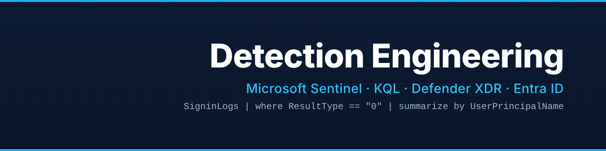
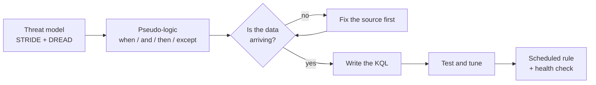

<p align="center">
  
</p>

<p align="center">
  <a href="https://www.linkedin.com/in/rabiatu-mohammed-azure/"></a>
  <a href="https://rabiatucloud.hashnode.dev"></a>
  <a href="https://github.com/RabiatuMohammed/sentinel-detections"></a>
</p>

```kql
SecurityEngineers
| where Name == "Rabiatu Mohammed"
| project Role   = "Detection Engineer",
          Stack  = "Microsoft Sentinel, Defender XDR, Entra ID, KQL",
          Focus  = "Fewer, better alerts, and log sources that actually arrive",
          Base   = "Abuja, Nigeria",
          OpenTo = "UK, Ireland, Netherlands, Germany, Luxembourg"
```

I came to security from psychology and health care management. I start with what could go wrong for the people involved, then go and look for it in the logs.

> [!NOTE]
> **Working on now:** the Binance hack (October 2026). Mapping each stage of the attack to Microsoft telemetry and writing a detection for each.

### How I build a detection



### Detection log

| When | What | Result |
|---|---|---|
| Oct 2026 | Leaver account sign-in detection | First version returned 103 rows for one leaver. Now it raises one alert with the sign-ins, apps and IPs in it. |
| Oct 2026 | Data-source health checks | Found 3 of 6 log sources silent for 30 days with no error anywhere. 4 of 10 rules could not fire. |
| Oct 2026 | Silent source rule (DA-02) | Hourly rule with its own allowed silence per table. 0 alerts across 50 simulated runs on current data. |
| In progress | Binance hack exercise | One detection per attack stage. |

<details>
<summary><b>See the query: leaver account still signing in</b></summary>

<br/>

Someone has left, but their account wasn't disabled. Their sign-ins look normal, so location rules miss them. This joins sign-ins to HR's leavers list and only counts sign-ins after the leave date.

```kql
let Leavers = Watchlist
    | where TimeGenerated > ago(90d)
    | where WatchlistAlias == "Leavers"
    | summarize arg_max(TimeGenerated, *) by _DTItemId
    | where _DTItemStatus != "Delete"
    | extend RawDate = coalesce(tostring(WatchlistItem["LeaveDate"]), tostring(WatchlistItem[" LeaveDate"]))
    | project UPN = tolower(trim(@"\s", tostring(SearchKey))), LeaveDate = todatetime(trim(@"\s", RawDate));
SigninLogs
| where TimeGenerated > ago(7d)
| where ResultType == "0"
| extend UPN = tolower(UserPrincipalName)
| join kind=inner Leavers on UPN
| where TimeGenerated > LeaveDate
| summarize SignIns = count(), FirstSeen = min(TimeGenerated), LastSeen = max(TimeGenerated),
            Apps = make_set(AppDisplayName), IPs = make_set(IPAddress)
            by UPN, LeaveDate
```

Why `coalesce()` and `trim()`? The CSV had been saved with a space after each comma, so the column was really `" LeaveDate"`. Full notes in [sentinel-detections](https://github.com/RabiatuMohammed/sentinel-detections).

</details>

<details>
<summary><b>See the idea: catching a log source that goes quiet</b></summary>

<br/>

A rule can be switched on and look healthy while the table it reads has stopped receiving data. Nothing errors. DA-02 runs every hour and gives each table its own allowed silence: sign-in logs should never be quiet for a day, but admin logs in a small tenant can be quiet for three.

| Table | Allowed silence |
|---|---|
| AADNonInteractiveUserSignInLogs | 6 hours |
| SigninLogs | 24 hours |
| OfficeActivity | 12 hours |
| AuditLogs | 72 hours |

Full rule: [DA-02-critical-log-source-silent.kql](https://github.com/RabiatuMohammed/sentinel-detections/blob/main/assurance/DA-02-critical-log-source-silent.kql)

</details>

### Latest writing

<!-- BLOG-POST-LIST:START -->
- [How to Set Up Ping URL Tests and Health Checks with Azure Monitor Application Insights.](https://rabiatucloud.hashnode.dev/how-to-set-up-ping-url-tests-and-health-checks-with-azure-monitor-application-insights)
- [Create and Test an ASP.NET Core App in Azure DevOps Pipelines](https://rabiatucloud.hashnode.dev/create-and-test-an-aspnet-core-app-in-azure-devops-pipelines)
- [Adding and Configuring Jenkins Nodes for Pipeline Efficiency](https://rabiatucloud.hashnode.dev/adding-and-configuring-jenkins-nodes-for-pipeline-efficiency)
<!-- BLOG-POST-LIST:END -->

### Also

- Two IEEE conference papers (2025): MapReduce on IaaS clouds, and DevSecOps refactoring of a legacy app
